<p align="center">
  
</p>

<h1 align="center">Container Desktop</h1>

<p align="center">
  <strong>The Docker Desktop experience for Apple's native <code>container</code> runtime.</strong><br>
  A native SwiftUI app to run, inspect and manage Linux containers on your Mac. No daemon, no license fees.
</p>

<p align="center">
  <a href="https://github.com/AIFlow-Labs-Limited/aiflowlabs-apple-containers-ui/releases"></a>
  <a href="LICENSE"></a>
  
  <a href="https://aiflowlabs.io"></a>
</p>

<p align="center">
  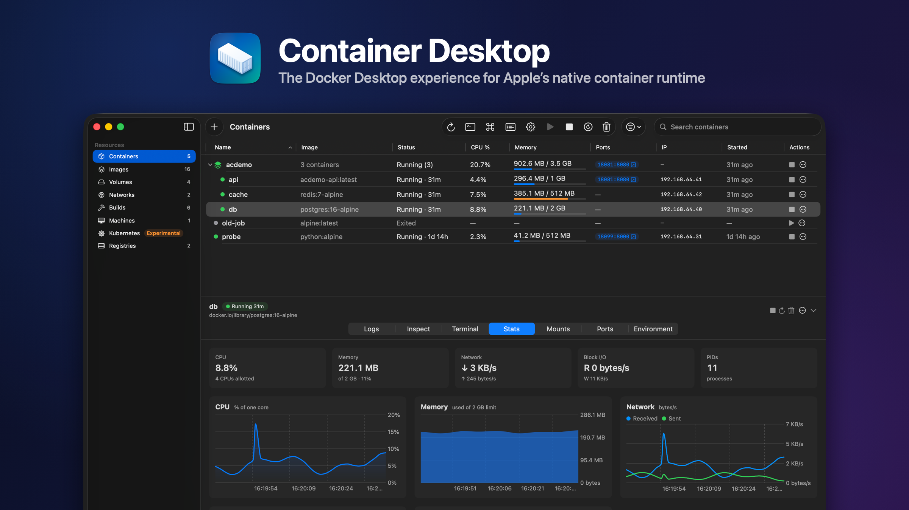
</p>

<p align="center">
  <a href="#install">Install</a> ·
  <a href="#what-you-get">Features</a> ·
  <a href="#demo">Demo</a> ·
  <a href="#how-it-works">How it works</a> ·
  <a href="#roadmap">Roadmap</a>
</p>

## Why this exists

Apple shipped [`container`](https://github.com/apple/container): every Linux container runs in its own lightweight
virtual machine on the open-source [Containerization](https://github.com/apple/containerization) framework. It
speaks OCI images, needs no background daemon and costs nothing. It ships as a command-line tool only.

If you come from Docker Desktop, you lose the window you live in: what is running, one-click start and stop, logs,
a shell into a container, images, disk usage.

Container Desktop is that window. It keeps Docker Desktop's layout and vocabulary, so there is nothing to
re-learn, behaves like a Mac app (SF Symbols, native tables, Settings, a menu bar extra, light and dark), and exposes
what only Apple's runtime has: container machines, DNS domains, Rosetta for `amd64` images and local Kubernetes.

> **Status: v0.1, pre-1.0.** It works against `container` 1.5. Expect rough edges until 1.0, and builds that are
> not notarized yet (see [Install](#install)).

## What you get

<table>
  <tr>
    <td width="50%" valign="top">
      <picture>
        <source media="(prefers-color-scheme: dark)" srcset="docs/screenshots/container-logs-dark.png">
        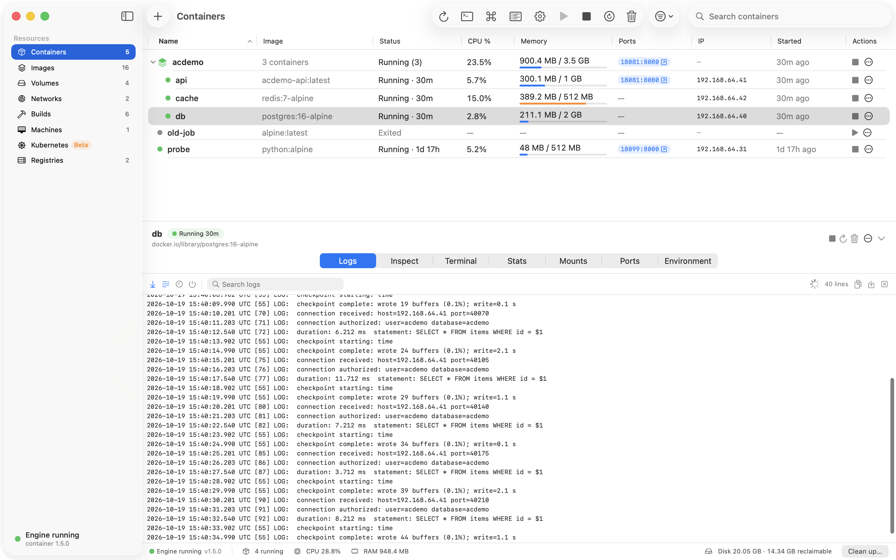
      </picture>
      <h3>Containers</h3>
      Status, CPU, memory, ports and IP in one table, with compose-style stacks grouped by project label.
      Start, stop, restart, kill and delete, one at a time or in bulk. Detail tabs for <b>Logs</b> (follow, search,
      timestamps, boot log), <b>Inspect</b>, <b>Terminal</b>, <b>Stats</b>, <b>Mounts</b>, <b>Ports</b> and
      <b>Environment</b>.
    </td>
    <td width="50%" valign="top">
      <picture>
        <source media="(prefers-color-scheme: dark)" srcset="docs/screenshots/container-terminal-dark.png">
        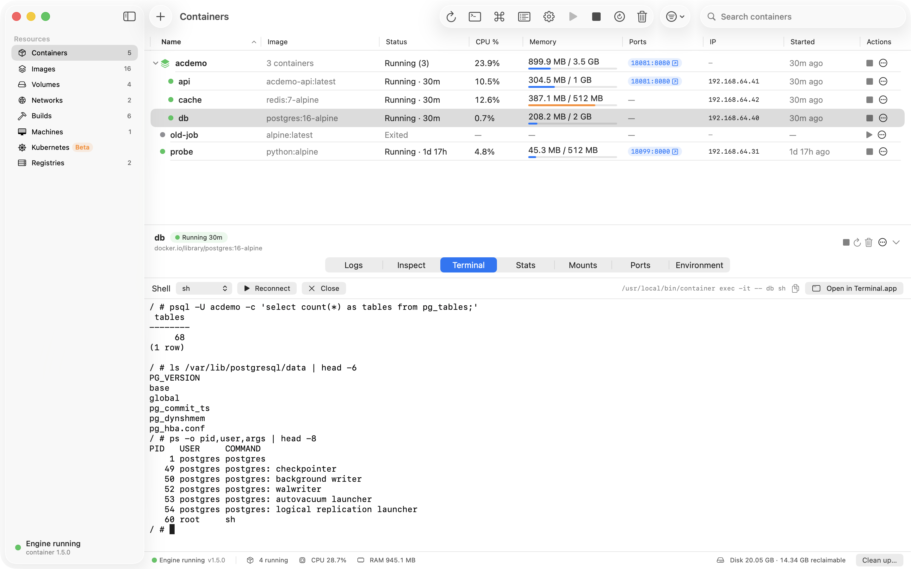
      </picture>
      <h3>A real terminal</h3>
      An embedded terminal runs <code>container exec -it</code> with the shell you pick, or opens the same
      command in Terminal.app.
    </td>
  </tr>
  <tr>
    <td valign="top">
      <picture>
        <source media="(prefers-color-scheme: dark)" srcset="docs/screenshots/run-container-dark.png">
        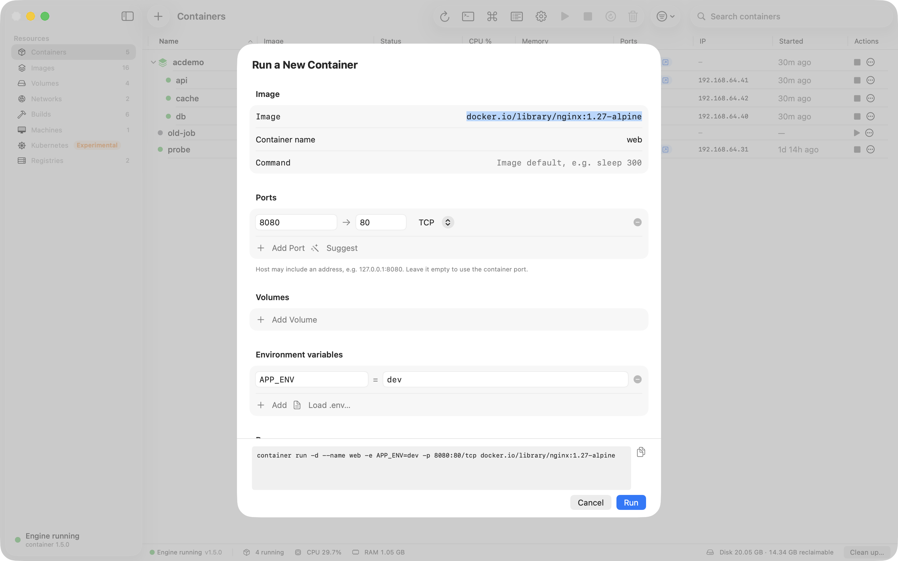
      </picture>
      <h3>Run sheet</h3>
      Image, name, command, ports (suggested from the image's <code>EXPOSE</code>), volumes and binds, env and
      <code>.env</code> files, CPU and memory, platform, network and more. The exact <code>container run</code>
      command is previewed as you type and can be copied.
    </td>
    <td valign="top">
      <picture>
        <source media="(prefers-color-scheme: dark)" srcset="docs/screenshots/image-detail-dark.png">
        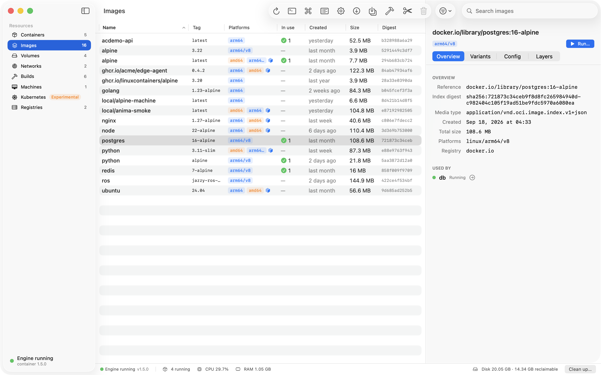
      </picture>
      <h3>Images</h3>
      Pull (with platform), tag, push, save and load tar files, and prune with the reclaimable size shown first.
      Platform badges, which containers use an image, variants, config and layers.
    </td>
  </tr>
  <tr>
    <td valign="top">
      <picture>
        <source media="(prefers-color-scheme: dark)" srcset="docs/screenshots/volumes-dark.png">
        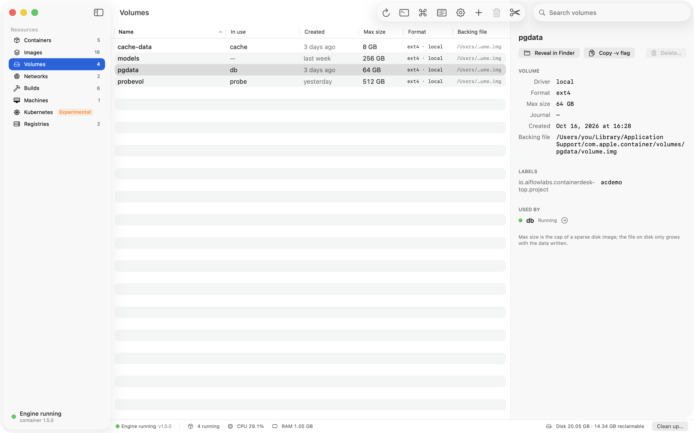
      </picture>
      <h3>Volumes and networks</h3>
      Create, inspect and prune volumes and networks, see which containers use them, reveal a volume's disk image
      in Finder, and copy the <code>-v</code> or <code>--network</code> flag.
    </td>
    <td valign="top">
      <picture>
        <source media="(prefers-color-scheme: dark)" srcset="docs/screenshots/build-sheet-dark.png">
        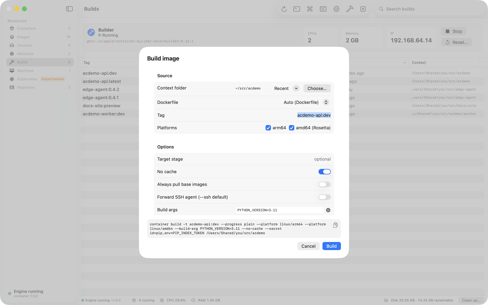
      </picture>
      <h3>Builds</h3>
      Builder status and sizing, and a build sheet for context, Dockerfile, tags, platforms, build args, target,
      secrets and SSH. Builds stream a live log and are kept in a local history.
    </td>
  </tr>
  <tr>
    <td valign="top">
      <picture>
        <source media="(prefers-color-scheme: dark)" srcset="docs/screenshots/machines-dark.png">
        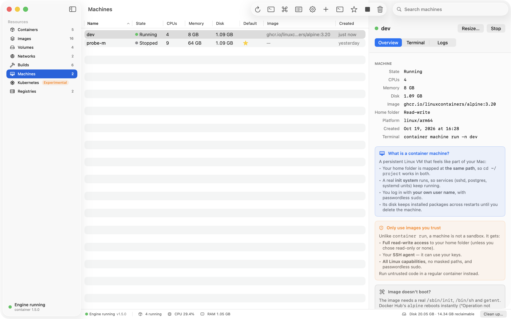
      </picture>
      <h3>Container machines <sub>Apple only</sub></h3>
      Persistent Linux dev machines with your home folder mapped at the same path. Create from images known to
      boot, open a terminal, resize, set the default.
    </td>
    <td valign="top">
      <picture>
        <source media="(prefers-color-scheme: dark)" srcset="docs/screenshots/kubernetes-dark.png">
        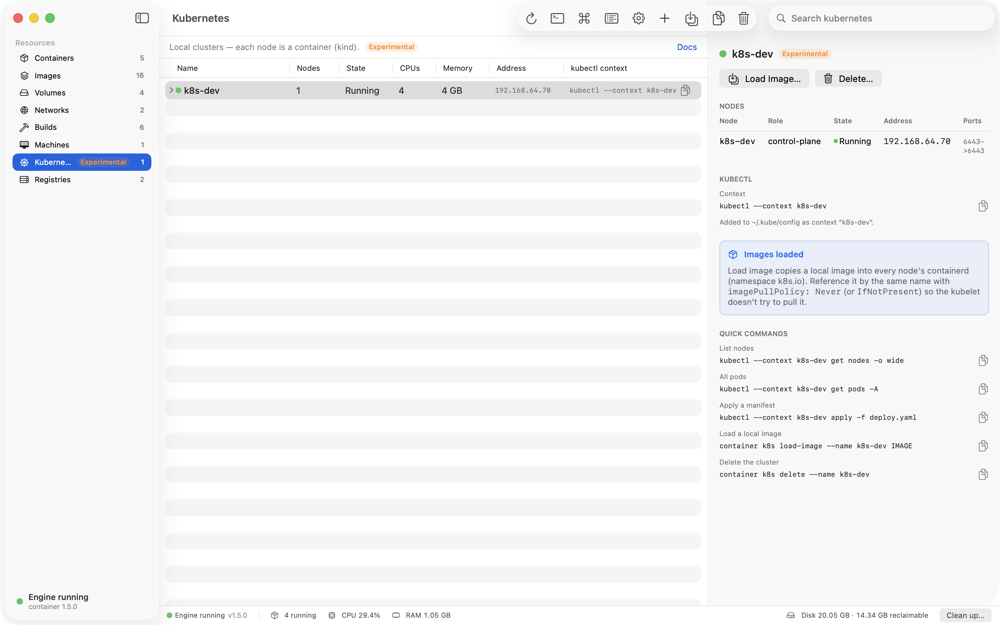
      </picture>
      <h3>Local Kubernetes <sub>experimental</sub></h3>
      Clusters through the <code>container</code> k8s plugin, where each node is a container. Create, delete,
      load local images into a cluster, copy the <code>kubectl --context</code>. Shown only when the plugin is installed.
    </td>
  </tr>
  <tr>
    <td valign="top">
      <picture>
        <source media="(prefers-color-scheme: dark)" srcset="docs/screenshots/settings-network-dark.png">
        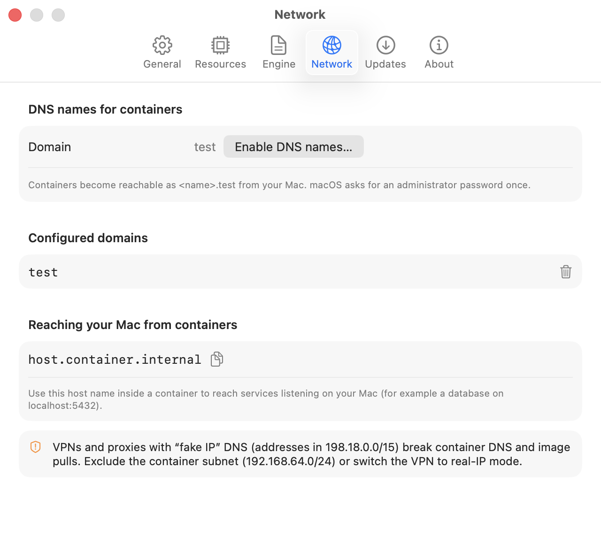
      </picture>
      <h3>DNS domains and settings <sub>Apple only</sub></h3>
      Make containers reachable as <code>&lt;name&gt;.test</code> through the standard admin prompt. Default CPU and
      memory for containers, the builder and machines, a validated <code>config.toml</code> editor, engine start
      and stop.
    </td>
    <td valign="top">
      <picture>
        <source media="(prefers-color-scheme: dark)" srcset="docs/screenshots/command-palette-dark.png">
        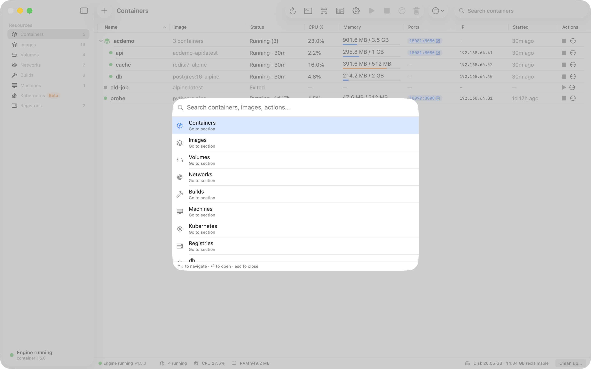
      </picture>
      <h3>Keyboard first</h3>
      <kbd>⌘K</kbd> jumps to any container, image or volume and runs actions. <kbd>⌘N</kbd> opens the Run sheet,
      <kbd>⌘1</kbd>–<kbd>⌘8</kbd> switch sections. Long-running work (pulls, builds, machine and cluster creation)
      streams into the Activity window.
    </td>
  </tr>
</table>

Also included: a menu bar extra (running containers, engine start and stop), a status bar with engine state,
running count, CPU, RAM and disk usage, a **Clean up** sheet that names what it will remove, registry logins for
Docker Hub, GHCR and others (passwords go to the CLI over stdin only), and `linux/amd64` runs and builds through
Rosetta next to native `arm64`. More screens: [`docs/screenshots/`](docs/screenshots/).

## Demo

<p align="center">
  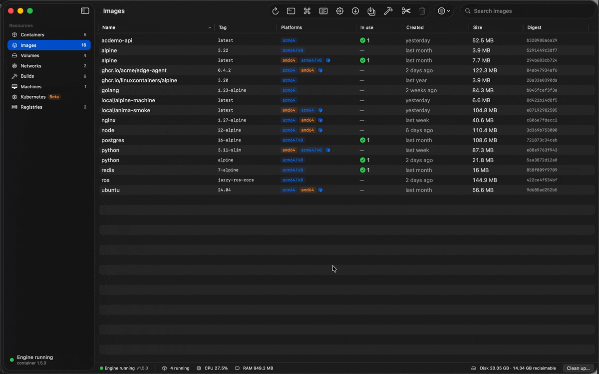
</p>

Pull an image, watch it stream into Activity, run a container from the Run sheet, then read its logs and open a
shell. A higher-quality [MP4](docs/launch/demo.mp4) is in the repo.

## Install

**Requirements:** macOS 26 (Tahoe) on Apple silicon.

1. **Install Apple's `container` 1.5 or later** from
   [github.com/apple/container/releases](https://github.com/apple/container/releases) and run
   `container system start` once (or press **Start** in the app).
2. **Download** `Container-Desktop-<version>-arm64.dmg` from
   [Releases](https://github.com/AIFlow-Labs-Limited/aiflowlabs-apple-containers-ui/releases), open it and drag
   *Container Desktop* to *Applications*. Each release has a `.sha256` file to check the download against.
3. **First launch.** Builds are ad-hoc signed and not notarized yet, so macOS blocks the first launch
   (right-click → Open no longer bypasses this, and a quarantined ad-hoc app can be reported as "damaged"). Either
   open the app once, then go to **System Settings → Privacy & Security** and click **Open Anyway**, or remove the
   quarantine flag:

   ```bash
   xattr -dr com.apple.quarantine "/Applications/Container Desktop.app"
   ```

**Homebrew:** a cask is coming. Until then, use the DMG.

### Build from source

Xcode 27 (or a Swift 6.2+ toolchain) on macOS 26:

```bash
git clone https://github.com/AIFlow-Labs-Limited/aiflowlabs-apple-containers-ui.git
cd aiflowlabs-apple-containers-ui
make run-mock   # launch against recorded CLI fixtures, no runtime needed
make run        # launch against your real `container` installation
make dmg        # build/Container-Desktop-<version>-arm64.dmg
```

## How it works

```
SwiftUI views ─▶ @Observable stores (AppCore) ─▶ ContainerBackend protocol (ContainerKit)
                                                   ├─ CLIBackend   runs `container … --format json` (today)
                                                   ├─ MockBackend  recorded CLI 1.5 fixtures (previews, tests)
                                                   └─ XPC backend  talks to the container services directly (planned)
```

- **The UI never shells out.** Every action goes through `ContainerBackend`, so the CLI backend can be swapped
  for an XPC backend without touching a view.
- **Models mirror the CLI's JSON**, and unknown values decode to `.unknown` instead of failing, so a new CLI
  release does not break the app.
- **Tests run against fixtures recorded from the real CLI** (`swift test`, no runtime needed). CI is manual-only;
  the gate is `make check` (build, tests, `swift format lint --strict`), run locally and by a pre-push hook.

Details in [`docs/ARCHITECTURE.md`](docs/ARCHITECTURE.md); scope in [`docs/PRD.md`](docs/PRD.md).

## Roadmap

- **v0.1 (this release):** the dashboard. Containers, Images, Volumes, Networks, Builds, Machines, Kubernetes,
  Registries, engine control, settings, menu bar extra; ad-hoc signed DMG.
- **v0.2:** compose-file import, a file browser inside containers, a signed and notarized DMG.
- **v0.3:** XPC backend (no CLI round-trips), menu-bar-only mode.
- **Later:** remote hosts.

Ideas and votes are welcome in [Issues](https://github.com/AIFlow-Labs-Limited/aiflowlabs-apple-containers-ui/issues).

## Contributing

Contributions are welcome. Start with [`CONTRIBUTING.md`](CONTRIBUTING.md): setup, `make check`, branch and
commit conventions. `make run-mock` gives you the whole app on recorded data, and every view has a SwiftUI preview.
Please report security issues privately as described in [`SECURITY.md`](SECURITY.md).

## License

[MIT](LICENSE) © 2026 AIFLOW LABS LIMITED.

Container Desktop is an independent project. It is not affiliated with or endorsed by Apple Inc. or Docker, Inc.;
"Docker Desktop" is used only to describe familiar concepts.

## Credits

- [apple/container](https://github.com/apple/container) and
  [apple/containerization](https://github.com/apple/containerization), the runtime this app drives.
- [SwiftTerm](https://github.com/migueldeicaza/SwiftTerm) by Miguel de Icaza, the embedded terminal.

## About AIFLOW LABS

[AIFLOW LABS](https://aiflowlabs.io) builds robotics and physical-AI software. We build our own tools in the open,
and Container Desktop is the one we use every day on our Macs.
