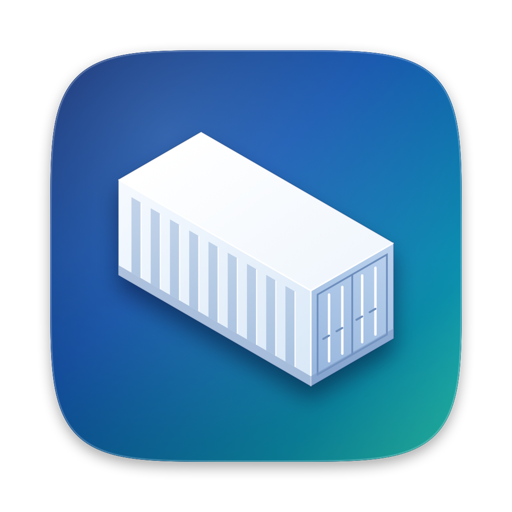
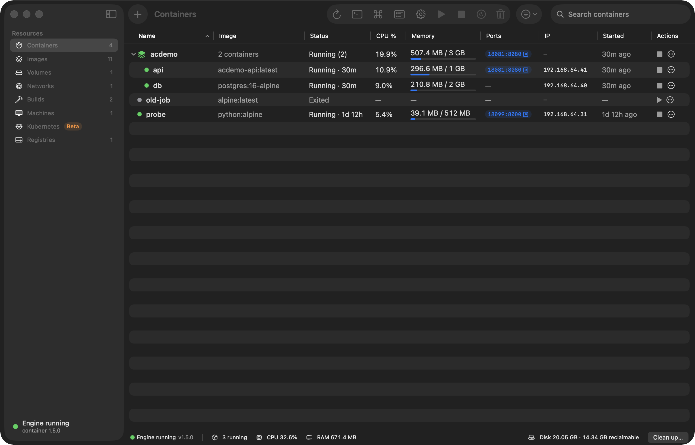
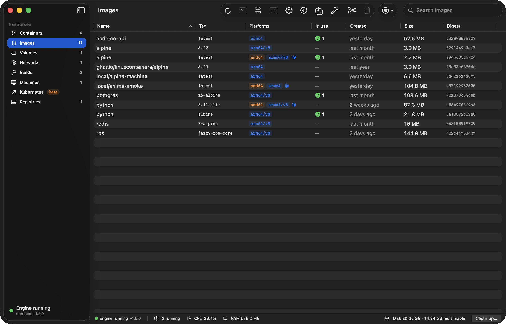
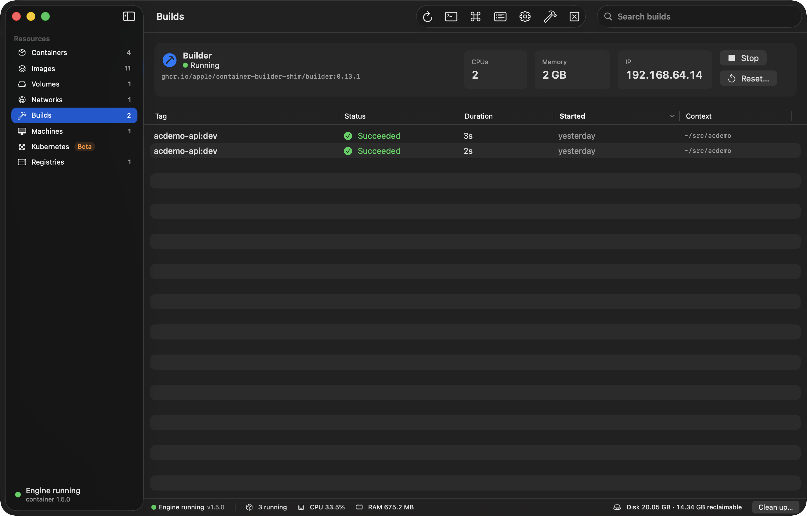
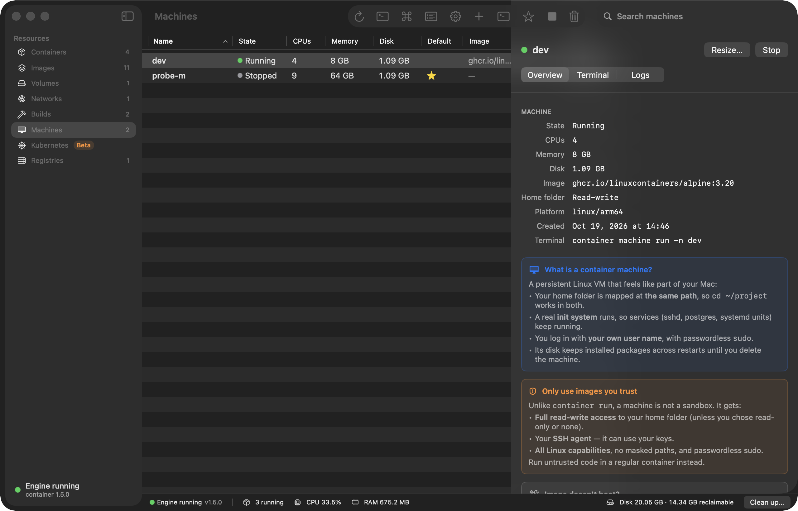
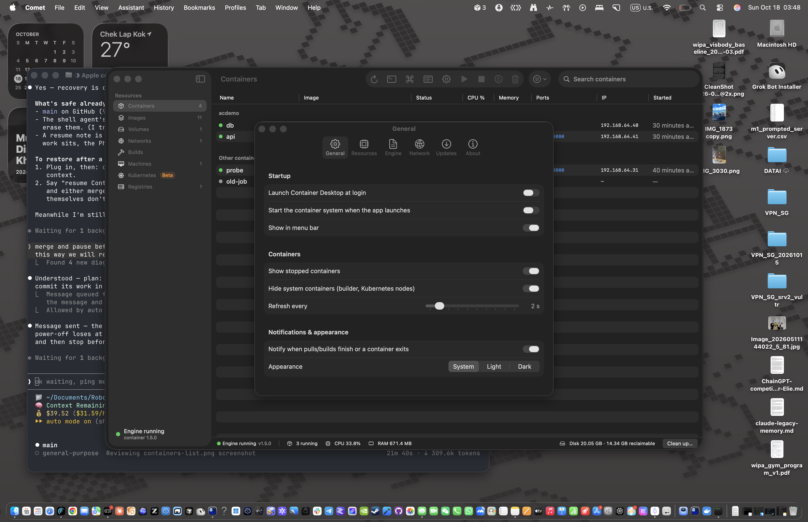
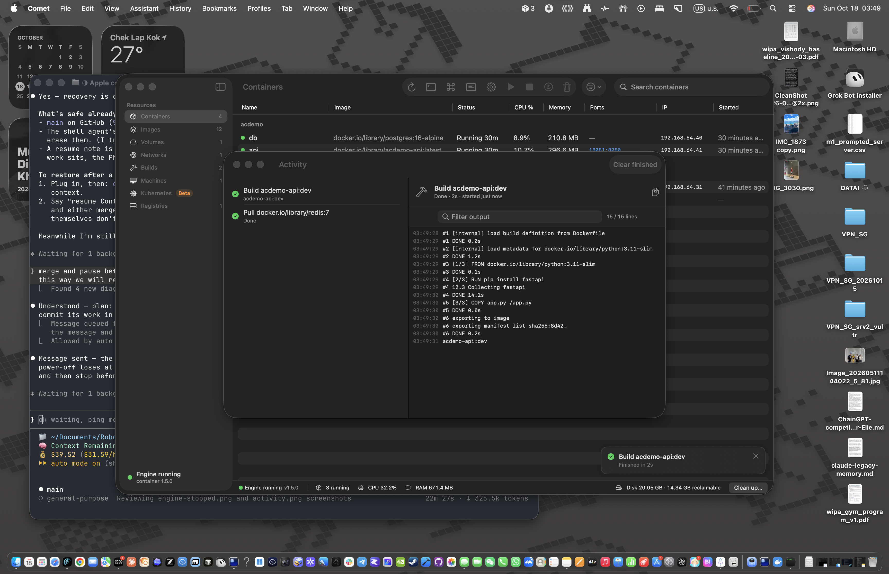

<p align="center">
  
</p>

<h1 align="center">Container Desktop</h1>

<p align="center">
  <strong>The Docker Desktop experience for Apple's native <code>container</code> runtime.</strong><br>
  A native SwiftUI dashboard to run, inspect and manage Linux containers on your Mac — no daemon, no license fees.
</p>

<p align="center">
  <a href="https://github.com/AIFlow-Labs-Limited/aiflowlabs-apple-containers-ui/actions/workflows/ci.yml"></a>
  <a href="https://github.com/AIFlow-Labs-Limited/aiflowlabs-apple-containers-ui/releases"></a>
  <a href="LICENSE"></a>
  
</p>

> **Status: pre-1.0.** Every section in the table below works against `container` 1.5. Expect rough edges and
> breaking changes until 1.0, and builds that are not yet notarized (see [Install](#install)).

## Why

Apple's [`container`](https://github.com/apple/container) runs every Linux container in its own lightweight
virtual machine, built on the open-source [Containerization](https://github.com/apple/containerization)
framework. It speaks OCI images, needs no background Docker daemon, and costs nothing to use. What it doesn't
have is a GUI. If you are coming from Docker Desktop you lose the window you relied on: what's running, one-click
start/stop, logs, a shell into a container, images, disk usage.

Container Desktop is that window. It keeps Docker Desktop's layout and vocabulary so there is nothing to
re-learn, looks and behaves like a native Mac app, and exposes what is unique to Apple's runtime.

## Features

| Area | Docker Desktop equivalent | What you get |
|---|---|---|
| **Containers** | Containers | Live table with status, CPU, memory, ports and IP; start/stop/restart/kill/delete; detail tabs for Logs, Inspect, Terminal, Stats, Mounts, Ports; a *Run* sheet that previews the exact `container run` command |
| **Images** | Images | Pull (with platform), tag, push, save/load, prune with reclaimable size; layers, config and platform badges |
| **Volumes** | Volumes | Create, inspect, see which containers use them, prune, reveal in Finder |
| **Networks** | Networks | Create isolated networks (IPv4/IPv6 subnets), see attached containers, prune |
| **Builds** | Builds | Builder status and sizing, build sheet (context, Dockerfile, tags, platforms, args, secrets) with a live log and history |
| **Registries** | Sign in | Logins for Docker Hub, GHCR and others; passwords go to the CLI via stdin only |
| **Machines** | — (Apple-only) | Linux dev machines with your home folder mapped: create, open a terminal, resize, set default |
| **Kubernetes** | Kubernetes | Local clusters via the `container` k8s plugin (experimental, shown only when installed) |
| **DNS domains** | — (Apple-only) | Set up `*.test`-style local domains for containers through the standard admin prompt |
| **Rosetta / multi-arch** | Platform flag | Run and build `linux/amd64` images through Rosetta alongside native `arm64` |
| **Engine & settings** | Settings / Resources | Start/stop the engine, default CPU and memory, a validated `config.toml` editor, menu bar extra |

The table describes the v1 scope in [`docs/PRD.md`](docs/PRD.md); see the [Roadmap](#roadmap) for what is
shipping when.

## Screenshots

| Containers | Images | Builds |
|---|---|---|
|  |  |  |

| Machines | Settings | Activity |
|---|---|---|
|  |  |  |

## Install

**Requirements:** macOS 26 (Tahoe) on Apple silicon, and Apple's `container` **1.5 or later** from
[github.com/apple/container/releases](https://github.com/apple/container/releases).

- **DMG:** download `Container-Desktop-<version>-arm64.dmg` from
  [Releases](https://github.com/AIFlow-Labs-Limited/aiflowlabs-apple-containers-ui/releases), open it and drag
  *Container Desktop* to *Applications*.
- **Homebrew:** a tap is coming — for now, use the DMG.

**First launch of an unsigned build.** Until a Developer ID is configured, release builds are ad-hoc signed and not
notarized, so macOS blocks them the first time (right-click → Open no longer bypasses this on recent macOS, and a
quarantined ad-hoc app can be reported as "damaged"). Either:

1. Open the app once, then go to **System Settings → Privacy & Security**, scroll to the message about
   *Container Desktop* and click **Open Anyway**; or
2. remove the quarantine flag in Terminal:

   ```bash
   xattr -dr com.apple.quarantine "/Applications/Container Desktop.app"
   ```

Check the download against the `.sha256` file published with each release before doing either.

After installing `container`, run `container system start` once (or press **Start** in the app).

## Build from source

You need Xcode 27 (or a Swift 6.2+ toolchain) on macOS 26.

```bash
git clone https://github.com/AIFlow-Labs-Limited/aiflowlabs-apple-containers-ui.git
cd aiflowlabs-apple-containers-ui
make app        # → build/Container Desktop.app (release build, ad-hoc signed)
make run-mock   # launch against recorded CLI fixtures — no runtime needed
make run        # launch against your real `container` installation
make check      # build + test + lint
make dmg        # → build/Container-Desktop-<version>-arm64.dmg
```

`make help` lists all targets.

## How it works

```
SwiftUI views ─▶ @Observable stores (AppCore) ─▶ ContainerBackend protocol (ContainerKit)
                                                   ├─ CLIBackend   — runs `container … --format json` (today)
                                                   ├─ MockBackend  — recorded CLI 1.5 fixtures (previews, tests)
                                                   └─ XPC backend  — talks to the container services directly (planned)
```

The UI never shells out: every action goes through the `ContainerBackend` protocol, so the CLI backend can later
be swapped for a direct XPC backend without touching views. Models mirror the CLI's JSON so new CLI fields
don't break decoding. Details in [`docs/ARCHITECTURE.md`](docs/ARCHITECTURE.md).

## Roadmap

- **v0.1** — the dashboard: Containers, Images, Volumes, Networks, Builds, Machines, Registries, engine control,
  settings; an ad-hoc signed DMG.
- **Next** — a signed + notarized DMG once a Developer ID is configured, and the Homebrew tap.
- **v0.2** — compose-file import, a file browser inside containers.
- **v0.3** — XPC backend (no CLI round-trips), menu-bar-only mode.
- **Later** — remote hosts.

Ideas and votes are welcome in [Issues](https://github.com/AIFlow-Labs-Limited/aiflowlabs-apple-containers-ui/issues).

## Contributing

Contributions are welcome. Start with [`CONTRIBUTING.md`](CONTRIBUTING.md) (setup, `make check`, branch and
commit conventions). Please report security issues privately as described in [`SECURITY.md`](SECURITY.md).

## License

[MIT](LICENSE) © 2026 AIFLOW LABS LIMITED.

Container Desktop is an independent project. It is not affiliated with or endorsed by Apple Inc. or Docker, Inc.;
"Docker Desktop" is used only to describe familiar concepts.

## Credits

- [apple/container](https://github.com/apple/container) and
  [apple/containerization](https://github.com/apple/containerization) — the runtime this app drives.
- [SwiftTerm](https://github.com/migueldeicaza/SwiftTerm) by Miguel de Icaza — the embedded terminal.
